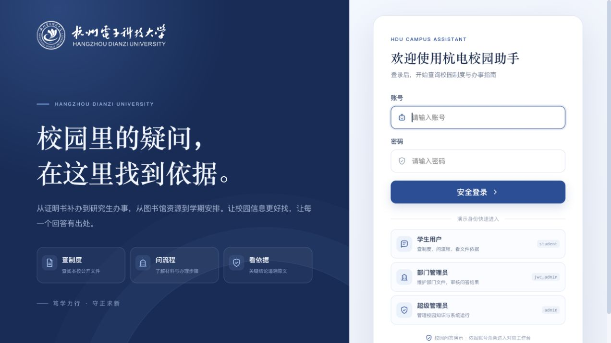
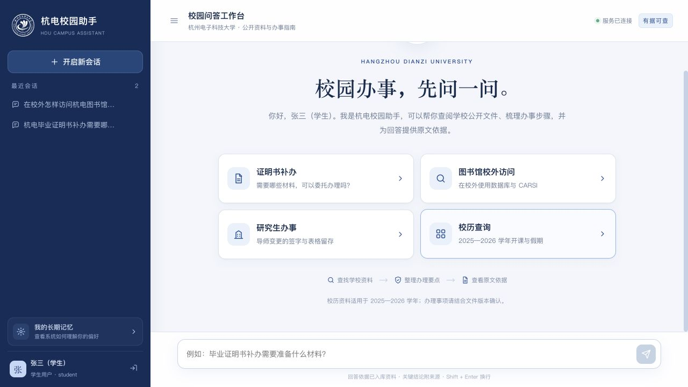
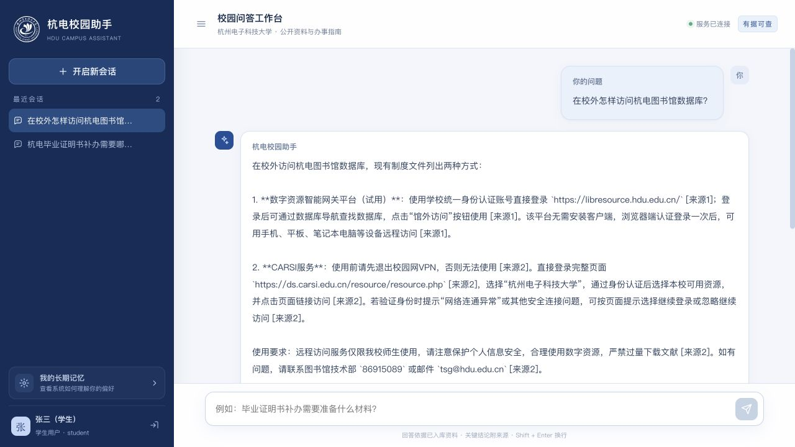
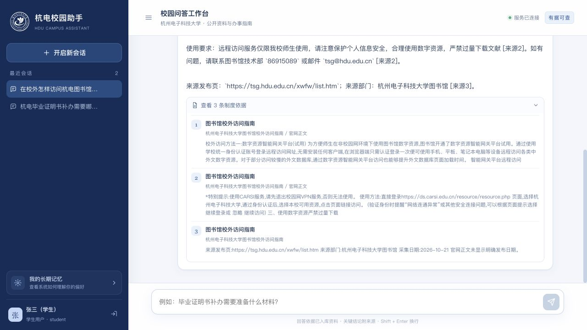
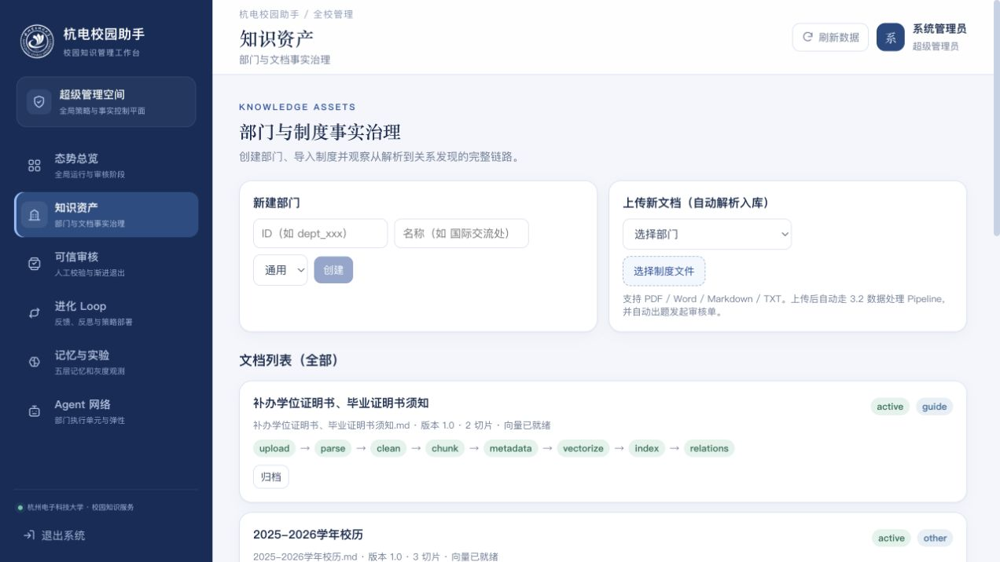
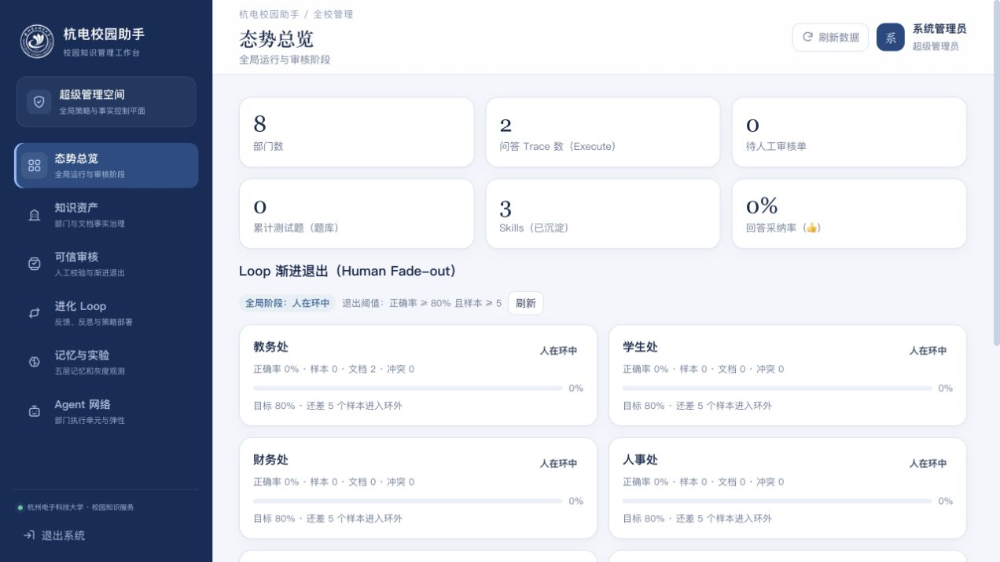
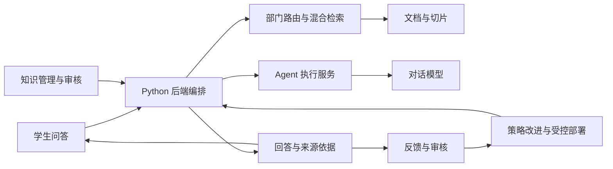

# 杭电校园助手

校园里的疑问，在这里找到依据。

杭电校园助手是一个以杭州电子科技大学公开资料为知识库的校园问答与管理项目。学生可以直接询问办事材料、办理流程和学期安排，查看回答引用的文件片段；管理员可以维护部门文档、审核问答结果，并跟踪反馈与策略调整。

项目采用校徽蓝作为界面主色，提供学生问答工作台和校园知识管理工作台，覆盖“资料入库 → 检索问答 → 来源核对 → 人工审核 → 反馈改进”的完整流程。

[界面展示](#界面展示) · [功能与场景](#功能与场景) · [快速启动](#快速启动) · [演示指南](#演示指南) · [项目结构](#项目结构) · [技术文档](#技术文档)

## 界面展示

以下为本地运行版本的实际截图，采集于 2026-10-21。文档数量、会话记录和审核统计会随使用变化。

### 登录与身份选择

以深蓝色校标区搭配浅色登录卡片，提供学生、部门管理员、超级管理员三种演示身份。点击演示身份会填入账号信息，再点击“安全登录”进入对应工作台。



### 学生问答工作台

首页将证明书补办、图书馆校外访问、研究生办事和校历查询集中为四个入口。左侧管理历史会话和个人偏好，底部可以直接输入校园问题。



### 回答与原文依据

回答按问题整理办理步骤或使用方法，并通过“来源”编号关联检索材料。展开“查看制度依据”，可以核对文档标题、章节和原文片段。



<details>
<summary>查看展开后的原文依据</summary>



</details>

### 校园知识管理工作台

后台通过侧栏切换态势总览、知识资产、可信审核、进化 Loop、记忆与实验、Agent 网络。知识资产页面展示文档版本、切片数量、向量就绪状态和处理阶段，便于确认资料是否完成入库。



<details>
<summary>查看后台态势总览</summary>



</details>

## 功能与场景

### 学生端：查制度、问流程、看依据

| 功能 | 使用效果 |
| --- | --- |
| 校园资料问答 | 用自然语言询问材料、步骤、适用条件和时间安排 |
| 部门路由与混合检索 | 结合问题定位相关部门，通过关键词与向量检索查找文件片段 |
| 原文依据展示 | 在回答下查看引用的文档标题、章节和内容片段 |
| 历史会话 | 新建、切换和删除个人问答会话 |
| 回答反馈 | 对新生成的回答提交“有帮助”或“需改进”反馈，并复制答案 |
| 个人偏好记忆 | 经用户明确同意后保存回答风格等偏好，支持查看和删除 |

### 管理端：维护知识、审核结果、跟踪改进

| 页面 | 主要功能 |
| --- | --- |
| 态势总览 | 查看部门、问答记录、审核单、测试题和反馈统计 |
| 知识资产 | 管理部门，上传文档，查看处理状态、版本与归档状态 |
| 可信审核 | 核对系统生成的测试题与回答，累计审核样本和正确率 |
| 进化 Loop | 跟踪反馈、反思、策略生成与部署作业，查看 Skills、Hooks、Rules |
| 记忆与实验 | 查看记忆与实验信息，观察策略灰度运行情况 |
| Agent 网络 | 查看部门执行单元及其配置与运行信息 |

超级管理员管理全校范围；部门管理员的文档和治理操作受所属部门权限约束。审核阶段包括“人在环中”“人在环上”“人在环外”，按配置的审核统计与规则推进。

### 当前演示知识库

当前杭电素材包含 6 份官网正文整理材料和 1 份校历转录，分别归属教务处、图书馆和电子信息学院。官网原始网页、Word 附件以及来源与校验清单均保存在仓库中。

| 场景 | 已整理的资料 | 可以尝试的问题 |
| --- | --- | --- |
| 证明书补办 | 《补办学位证明书、毕业证明书须知》 | 毕业证明书补办需要哪些材料，可以委托办理吗？ |
| 图书馆校外访问 | 图书馆校外访问指南，涵盖智能网关与 CARSI | 在校外怎样访问杭电图书馆数据库？ |
| 研究生办事 | 导师变更、增退修课程、知识产权用印申请表及自助打印通知 | 导师变更申请表需要哪些签字，批准后如何留存？ |
| 校历查询 | 用户提供的 2025—2026 学年校历及结构化日期 | 根据该学年校历，2026 年春季哪天上课、哪天开始放暑假？ |

校历明确适用于 2025—2026 学年，不能直接作为其他学年的日程。回答范围取决于已入库文档；历史文件中的办理信息需结合部门后续通知确认。

素材来源与处理过程见 [来源清单](school_materials/hdu/manifest.json) 和 [素材说明](school_materials/hdu/README.md)。

## 快速启动

### 1. 准备环境配置

安装并启动 Docker Desktop，确认可使用 Docker Compose。以下命令在项目根目录执行；启动脚本还会使用 Bash、Make 和 curl。

```bash
# 仅首次创建配置；已有 .env 时直接编辑原文件
cp -n .env.example .env
```

根据 [配置示例](.env.example) 填写模型服务与存储配置。启动页面不等于模型调用已配置完成，导入资料和生成回答还需要有效的模型与 Embedding 服务。

| 配置项 | 用途 |
| --- | --- |
| `DEEPSEEK_API_KEY`、`DEEPSEEK_BASE_URL`、`DEEPSEEK_MODEL` | 对话模型访问配置 |
| `RELAY_API_KEY`、`RELAY_BASE_URL` | Embedding 等兼容接口的访问配置，沿用 relay 命名 |
| `EMBEDDING_PROVIDER`、`EMBEDDING_MODEL`、`EMBEDDING_DIM` | 文本向量生成方式、模型及对应维度 |
| `MONGO_INITDB_ROOT_USERNAME`、`MONGO_INITDB_ROOT_PASSWORD`、`REDIS_PASSWORD` | 数据库与缓存账号配置 |
| `AUTH_SECRET`、`INTERNAL_API_TOKEN` | 登录签名及服务间访问凭据 |
| `SEED_DEMO_USERS` | 是否初始化演示账号，本地演示可设为 `true` |

### 2. 启动服务

首次启动或修改应用代码后，构建并启动：

```bash
make up-build
```

已有镜像的日常启动：

```bash
make up
```

启动入口会在后台运行 MongoDB、Redis、后端、异步 Worker、Agent 服务和前端。前端页面与后端健康检查通过后，终端会显示：

```text
杭电校园助手已就绪

  前端地址：http://localhost:8080/
```

在 macOS 终端中，按住 Command 并点击地址即可打开。已运行的服务会被复用，无需先关闭网页或停止服务。

没有 Make 时，可使用 `bash scripts/start.sh`；需要构建时使用 `bash scripts/start.sh --build`。

### 3. 首次初始化与导入杭电资料

新数据库需要初始化学校配置并导入文档。已经完成导入的环境可以跳过此步骤。

```bash
# 初始化部门、术语、校历与默认策略
make seed

# 仅导入杭电资料目录
# 避免将其他学校示例或原始网页、附件重复加入演示知识库
docker compose exec backend python -m scripts.ingest_department_files --base /app/department_files/杭州电子科技大学
```

导入完成后，在管理端“知识资产”检查文档状态为 `active`、向量为“已就绪”，再验证学生问答。原始网页与 Word 附件位于 `school_materials/hdu/originals/`，用于追溯与下载；实际检索文本位于 `department_files/杭州电子科技大学/`。

### 4. 打开页面并登录

| 入口 | 默认地址 |
| --- | --- |
| 前端工作台 | [http://localhost:8080/](http://localhost:8080/) |
| 后端接口文档 | [http://localhost:8000/docs](http://localhost:8000/docs) |
| 后端健康检查 | [http://localhost:8000/healthz](http://localhost:8000/healthz) |
| Agent 服务健康检查 | [http://localhost:8100/health](http://localhost:8100/health) |

开启 `SEED_DEMO_USERS=true` 时，可使用以下本地演示账号：

| 身份 | 账号 | 密码 | 登录后页面 |
| --- | --- | --- | --- |
| 学生用户 | `student` | `student123` | 校园问答工作台 |
| 教务处管理员 | `jwc_admin` | `admin123` | 本部门知识管理工作台 |
| 超级管理员 | `admin` | `admin123` | 全校知识管理工作台 |

以上账号用于本地演示；公开部署前应关闭演示账号初始化、处理已创建的演示账号，并替换配置中的占位密码与密钥。

### 常用命令

| 操作 | 命令 |
| --- | --- |
| 日常启动 | `make up` |
| 重新构建并启动 | `make up-build` |
| 查看服务状态 | `docker compose ps` |
| 跟踪服务日志 | `make logs` |
| 查看前端日志 | `docker compose logs -f web` |
| 停止服务，保留数据库与上传数据卷 | `make down` |
| 模型配置与连通性诊断 | `make doctor` |

`make down` 不清空数据。下一次运行 `make up` 会继续使用原有数据卷。

## 演示指南

可以按下面的顺序展示项目，从学生提问走到知识维护：

1. 用学生账号登录，展示四个校园场景入口和左侧会话管理。
2. 点击“证明书补办”或“图书馆校外访问”，观察查找资料、整理回答的过程。
3. 展开回答下方的“查看制度依据”，对照文件标题和原文片段。
4. 提问“根据 2025—2026 学年校历，2026 年春季学期哪天开始上课、哪天开始放暑假？”，核对答案为 2026-03-05 和 2026-07-06。
5. 切换到超级管理员，展示“知识资产”中的学校文档、版本和向量状态，再查看“可信审核”与“进化 Loop”的管理入口。

新上传文档后的审核单、反馈驱动的策略产物和统计变化，需要完成相应流程后才会出现。初始化环境中的空列表和零统计代表尚未积累数据。

## 工作原理与技术栈

学生提交问题后，后端识别意图与相关部门，结合术语和对话上下文改写查询，再通过 BM25 与向量混合检索寻找有效文档片段。系统基于检索证据生成回答、检查引用与答案，并将结果和反馈送入后续审核与改进流程。



| 层次 | 技术与职责 |
| --- | --- |
| Web 界面 | Next.js 15、React 19、TypeScript；学生端与管理端角色分流 |
| 业务后端 | Python、FastAPI；权限、文档处理、问答编排与审核 |
| Agent 执行 | Node.js、pi-agent-core、pi-ai；执行意图、改写、回答、验证与反思任务 |
| 知识检索 | BM25、Embedding、混合检索；按有效文档与部门范围提供证据 |
| 数据与作业 | MongoDB 持久化文档和业务数据，Redis 支持会话与异步作业队列 |
| 部署 | Docker Compose 用于本地全栈运行，仓库另提供 Kubernetes / Helm 配置 |

文档及其切片是回答的事实来源；会话、用户偏好和反馈用于提供上下文与改进策略。部门权限、文档状态和策略发布由 Python 后端统一控制。

## 项目结构

```text
wenshu-project/
├── README.md                   # 项目介绍、界面展示与快速启动
├── Makefile                    # 日常操作入口
├── scripts/start.sh            # 启动、就绪检查与地址提示
├── docker-compose.yml          # 本地全栈服务编排
├── .env.example                # 环境配置示例
├── web/                        # 学生与管理端界面
├── backend/                    # API、检索、文档处理、审核与记忆
├── services/pi-agent/          # Agent 执行服务
├── department_files/           # 可导入的知识库文本
├── school_materials/hdu/        # 官网原件、附件与来源清单
├── doc/                        # 原 README 存档与界面截图
├── docs/                       # 架构、接口、部署及 Loop 文档
├── design_files/               # 技术方案、源码解读与页面使用指南
├── deploy/                     # Kubernetes / Helm 部署配置
└── loadtest/                   # 部门服务负载测试
```

## 技术文档

| 文档 | 内容 |
| --- | --- |
| [原 README 存档](doc/README-original.md) | 重写前的技术说明、历史配置与验证记录 |
| [前端页面使用指南](design_files/文枢-前端页面使用指南.md) | 页面操作、角色差异与使用流程 |
| [前端说明](web/README.md) / [后端说明](backend/README.md) / [Agent 服务说明](services/pi-agent/README.md) | 各模块运行与实现细节 |
| [系统架构](docs/architecture.md) / [接口说明](docs/api.md) | 服务职责、数据流与 API |
| [部署说明](docs/deployment.md) / [部署配置](deploy/README.md) | Docker 与 Kubernetes / Helm 配置 |
| [Loop 设计](docs/loop-engineering.md) / [记忆机制](backend/app/memory/README.md) | 反馈、策略改进与记忆治理 |
| [杭电素材说明](school_materials/hdu/README.md) | 官方资料来源、校历范围及导入方式 |
| [后端测试说明](backend/tests/README.md) / [负载测试](loadtest/README.md) | 测试入口与验证方式 |
